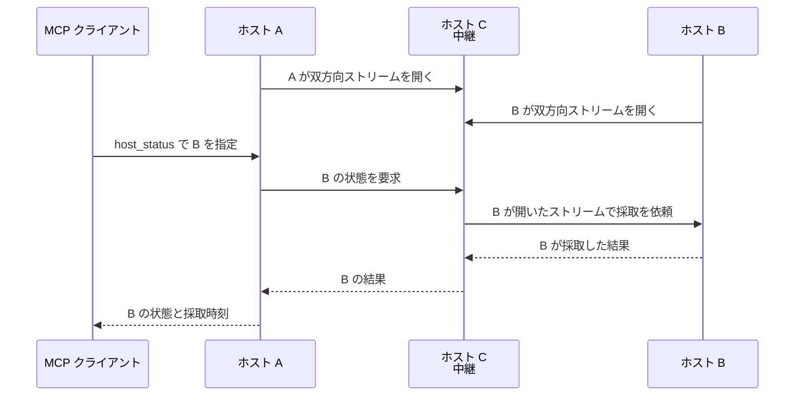

# host-status-mcp 設計

MCP クライアントは、接続先のサーバからローカルまたは別ホストの状態を取得する。当面の開発と配布対象は Linux の ARM64 と x86_64。Windows 対応は後続とし、macOS は実行環境を確保できた時点で扱うオプションの対応対象とする。各ホストは台帳を同期し、到達できるペアで自動的にフルメッシュを形成する。直結が使えないペアは、共通の中継を 1 台経由して照会する。約 100 台を想定し、閉域での平文ピア通信と、任意の mTLS を設計する。

## 接続構成

各プロセスは自分の状態を採取できる。単体モードは `stdio` で動かす。複数台では常駐モードを使い、MCP 受付、ホスト間の接続待ち受け、中継を配置ごとに有効にする。MCP 受付には公式 Go SDK の Streamable HTTP で `/mcp` を提供する。ホスト間には専用の gRPC 双方向ストリームを使う。接続を開始した側と受けた側の両方が、そのストリーム上で状態の採取を依頼できる。 [MCP Go SDK](https://github.com/modelcontextprotocol/go-sdk) [MCP のトランスポート](https://modelcontextprotocol.io/specification/2026-07-28/basic/transports) [gRPC Go のストリーミング](https://grpc.io/docs/languages/go/basics/#bidirectional-streaming-rpc)

| 到達条件 | ホスト間の設定 | A から B への照会 |
| --- | --- | --- |
| A から B の待ち受けにだけ到達できる | B は待ち受けを有効にし、接続アドレスを共有する。A が発見して接続する。 | A が開いたストリームを使う |
| B が A への外向き接続だけ開始できる | A は待ち受けを有効にし、接続アドレスを共有する。B が発見して接続する。 | B が開いたストリームを A から B に使う |
| A と B の直接接続が遮断され、両方とも C に接続できる | C は待ち受けと中継を有効にする。A と B は C を発見して接続し、許可された中継として使う。 | C が B への照会を取り次ぐ |

3 パターンすべてを PoC でサポートする。待ち受けと外向き接続は同じプロセスで併用できる。各ペアの少なくとも一方に接続を開始できる向きがあれば、そのペアは直結できる。直結が確立するまで、または経路障害が起きたときは、許可した共通の中継を使う。中継は自分に直接接続中の対象へ取り次ぐ。複数の中継が使える場合は ID 順で選ぶ。



ファイアウォール越しのライブ照会には、外側から内側へのデータも流せる確立済みの接続が必要になる。gRPC を通す経路では HTTP/2 の双方向ストリーミングとアイドルタイムアウトを実環境で確認する。データが物理的またはアプリケーション層で片方向にしか流せない環境では、内側から定期送信したスナップショットを採取時刻付きで閲覧する方式が候補になる。

100 台すべてが直結できる場合は 1 ペアにつき 1 接続で 4,950 接続、各ホストに 99 接続となる。中継役 1 台だけが待ち受ける配置では、残り 99 台からの 99 接続で全台間を照会できる。中継の停止中は、ローカル照会と確立済みの直結照会が使える。

## ホストの識別と台帳

| 項目 | 取得元と用途 |
| --- | --- |
| `node_id` | 初回に UUID を生成して永続化する。ホスト名や IP が変わった後も同じ ID で照会する。mTLS では証明書に結び付けて本人確認に使う。 |
| `hostname` | `os.Hostname()` が返す実行ホストの名前。接続時と変更時に通知する。 [Go の `os.Hostname`](https://pkg.go.dev/os#Hostname) |
| `os` | `runtime.GOOS` の値。Windows は `windows`、macOS は `darwin`、Linux は `linux`。 |
| `addresses` | インターフェースから採取した、管理設定で共有を許可された IP。台帳の表示と同名ホストの絞り込みに使う。 |
| `peer_endpoints` | ピア接続用に共有する `host:port`。待ち受け側が実際に到達できる DNS 名や IP を広告する。外向き専用ノードは空にする。 |

最初のノードは待ち受けで起動する。追加のノードは、参加先として到達できる既知のピアを `peer.seeds` に 1 台以上設定する。既知のピアは通常のノードでも中継でもよい。接続が成立すると両端が台帳を同期し、新しく得たレコードを次の同期でほかのピアにも伝える。同じ通信方式で接続網が一続きなら、更新が行き渡った時点で全ノードが同じ参加ノードを知る。分断中の追加や変更は、再接続後の同期で伝わる。

- 各ノードは自分の `node_id`、ホスト名、OS、共有可能な IP、接続アドレス、中継の設定、更新番号をレコードに載せる。待ち受けが NAT の内側にある場合は、必要に応じて外部から到達できるアドレスとポートを `peer.advertise` で指定する。Tailscale 上では tailnet から到達できる名前や IP を使う。
- 接続直後、変更時、定期的な同期では ID、更新番号、レコードのハッシュを交換し、未取得のレコードと新版を取得する。各ノードは自分の情報を変えたときに更新番号を増やし、台帳とともに永続化する。同じ版でハッシュが違う場合は競合として記録する。切断後も既知ノードとして表示し、管理者による登録取り消しは同期したレコードより優先する。
- 未接続のピアを発見したノードは、共有された接続アドレスに `Link` を張る。接続先の ID は台帳と照合する。ペアの片側だけに待ち受けがあれば、もう片側が発信する。両側で発信できる場合は双方が試行できる。接続試行の同時数を制限し、到達できない宛先はジッター付きバックオフで再試行する。

たとえば A と B が接続済みで、D が B から参加すると、D は台帳で A を見つけて接続する。到達条件と設定が同じなら、D が A から参加した場合も、同じ参加ノードと同じペアの直結に収束する。両方向から新しく接続できないペアには、双方が接続している許可済み中継が必要になる。台帳の同期はピア接続を何段でも伝わり、状態の照会は直結または中継 1 段で処理する。

照会先は `node_id`、または `hostname` と任意の `ip` で指定する。名前指定はその時点のローカル台帳で一度だけ ID に解決し、呼び出し元に閲覧を許可したレコードを候補にする。複数候補があれば `AMBIGUOUS_HOST` と候補の名前、IP、ID を返す。NAT や独立した LAN で名前とプライベート IP の両方が重複した場合も、ID で指定できる。同期途中でも台帳は利用できるため、対象を厳密に指す用途では永続 ID を使う。

## MCP のツール

| ツール | 入力 | 結果 |
| --- | --- | --- |
| `server_version` | `{}` | MCP の接続先サーバー名と、起動ログおよび `serverInfo.version` と同じ製品バージョン。 |
| `host_list` | `{}` | ローカル台帳で既知かつ閲覧できるホストの ID、名前、OS、IP、照会元から見た接続状態、最終確認時刻。照会元自身を `is_local` で示す。同期途中や分断中はその時点で把握している一覧を返す。 |
| `host_status` | `target` を省略するとローカル。指定する場合は `{"node_id":"…"}` または `{"hostname":"build","ip":"192.0.2.32"}`。`sections` を省略すると許可された標準項目を採取する。 | 対象ホスト、採取時刻、照会経路、要求された項目の値、項目ごとの採取エラー。 |
| `process_status` | ローカルの `pid`。 | 1 プロセスの名前、CPU 使用率、常駐メモリと `process_identity`。 |
| `process_kill` | `process_status` またはローカルの `processes` 一覧から取得した `pid` と `process_identity`。任意の `signal` は `TERM`（既定）または `KILL`。 | OS が受け付けたシグナルと対象 PID。 |

`server_version`、`host_list`、`host_status`、`process_status` に `readOnlyHint: true` を設定する。`process_kill` は `readOnlyHint: false`、`destructiveHint: true` とする。成功時は出力スキーマに沿った `structuredContent` と互換用のテキストを返す。`HOST_NOT_FOUND`、`AMBIGUOUS_HOST`、`UNREACHABLE`、`DEADLINE_EXCEEDED` などの照会エラーは、対応するコードを含む `isError: true` のツール結果にする。`HOST_NOT_FOUND` は照会元の台帳で該当する対象を見つけられなかったこと、`UNREACHABLE` は対象への経路を利用できなかったことを示す。 [MCP のツール仕様](https://modelcontextprotocol.io/specification/2026-07-28/server/tools) [Go SDK のツール注釈](https://pkg.go.dev/github.com/modelcontextprotocol/go-sdk/mcp#ToolAnnotations)

`process_kill` は Linux PoC のローカル操作とする。stdio で登録し、ループバックの HTTP では `allow_process_kill` が有効な場合に登録する。プロセスの識別子にはノード ID、OS の起動 ID、PID 名前空間、PID、プロセスの開始時刻を使う。操作時は対象の pidfd を開き、識別子を照合したうえでその pidfd にシグナルを送る。識別子の不一致、送信権限の不足、PID 1 とサーバー自身への操作はエラーにする。ピア間の RPC は状態照会を扱う。 [Linux の pidfd](https://man7.org/linux/man-pages/man2/pidfd_open.2.html) [pidfd によるシグナル送信](https://man7.org/linux/man-pages/man2/pidfd_send_signal.2.html)

たとえば A の `host_status` に `{"target":{"hostname":"build","ip":"192.0.2.32"},"sections":["memory"]}` を渡すと、B が採取した値を返す。

```json
{
  "node": {
    "node_id": "4ce34e19-8ab1-4cd7-bad9-89119a11542b",
    "hostname": "build",
    "os": "windows",
    "addresses": ["192.0.2.32"]
  },
  "observed_at": "2026-11-24T12:00:00Z",
  "route": {
    "kind": "relay",
    "relay_node_id": "a5affd92-2da7-4293-a0c5-3c26f98f8d05"
  },
  "sections": {
    "memory": {"total_bytes": 8589934592, "available_bytes": 5368709120}
  },
  "section_errors": {}
}
```

`route.kind` は `local`、`direct`、`relay` のいずれか。Tailscale を使う場合も `direct` は対象との直接の `Link`、`relay` は第三の `host-status-mcp` が照会を取り次いだことを示す。`observed_at` は対象ノードでの採取時刻を示す。`host_list` の `last_seen_at` は直結または許可済み中継を通じて対象の接続を確認した最終時刻とする。接続状態は照会元から見た `connected`、`disconnected`、`unknown` で表す。台帳同期で存在だけを知ったノードの接続状態は `unknown` とする。

## 3 OS 共通の採取項目

ツール名、引数、出力スキーマ、単位を 3 OS でそろえる。採取処理は対象ノードで動かし、各 OS の API から共通の結果型へ変換する。`node.os` は取得項目にかかわらず付ける。

| 項目 | 公開する値と定義 |
| --- | --- |
| `system` | OS が示す起動からの経過秒数 `uptime_seconds` と、実行バイナリのアーキテクチャ `process_arch`、採取元の `server_version`。`process_arch` は `runtime.GOARCH` の値。取得できる場合は OS の ID、名前、表示用バージョン、バージョン ID、カーネルのリリース番号も返す。 |
| `cpu` | OS が提供する CPU 時間カウンターを一定区間で測った集計使用率 `usage_percent` と測定区間 `sample_window_ms`。`logical_cpus_available` は `runtime.NumCPU()` が返す、起動時にこのプロセスが使える論理 CPU 数。 [gopsutil の CPU 採取](https://pkg.go.dev/github.com/shirou/gopsutil/v4/cpu#PercentWithContext) [Go の runtime.NumCPU](https://pkg.go.dev/runtime#NumCPU) |
| `memory` | 物理メモリの `total_bytes` と `available_bytes`。利用可能量の算出方法は OS によって異なる。たとえば Linux はカーネルの `MemAvailable`、macOS の gopsutil は空きと非アクティブのページ数、Windows は `GlobalMemoryStatusEx` の可用物理メモリを使う。 [Linux の実装](https://github.com/shirou/gopsutil/blob/master/mem/mem_linux.go) [macOS の実装](https://github.com/shirou/gopsutil/blob/master/mem/mem_darwin.go) [Windows の実装](https://github.com/shirou/gopsutil/blob/master/mem/mem_windows.go) |
| `filesystems` | 管理者が設定したローカルの絶対パスごとに `path`、`total_bytes`、`available_bytes` を返す。パスの例は Windows の `C:\`、macOS や Linux の `/`。容量の扱いは予約領域やクォータも含めて OS に従う。Windows は呼び出し元に利用可能な空き容量を使う。 [Windows の容量 API](https://learn.microsoft.com/en-us/windows/win32/api/fileapi/nf-fileapi-getdiskfreespaceexw) |

採取に失敗した項目はエラーを返し、取得できた値はそのまま返す。要求した項目を一つも採取できなかった場合は `COLLECTION_FAILED` を返し、エラー内の `section_errors` に項目ごとの理由を含める。共通の基本項目は上の項目とホスト情報。サービス管理、OS のイベントログ、cgroup、inode、UNIX のロードアベレージは、OS 固有の意味や API を持つ。

CPU とメモリには `gopsutil/v4` の `cpu` と `mem` を候補とする。稼働時間とディスク容量は、OS の読み取り API を呼ぶ小さな実装に分ける。確認した gopsutil v4.26.10 では、Windows の `disk` の初期化はレジストリ設定の変更を試み、`host` が取り込む `process` の初期化はデバッグ権限の有効化を試みる。採取の依存先はパッケージの初期化も含めて確認する。 [gopsutil v4](https://github.com/shirou/gopsutil) [Windows の disk 実装](https://github.com/shirou/gopsutil/blob/v4.26.10/disk/disk_windows.go#L66) [Windows の host 実装](https://github.com/shirou/gopsutil/blob/v4.26.10/host/host_windows.go) [Windows の process 実装](https://github.com/shirou/gopsutil/blob/v4.26.10/process/process_windows.go#L192)

Linux の `system` は `/etc/os-release` の `ID`、`NAME`、`VERSION`、`VERSION_ID` を読む。ファイルがなければ `/usr/lib/os-release` を使う。名前は `PRETTY_NAME`、表示用バージョンは `VERSION_ID` でも補える。カーネルのリリース番号は `uname(2)` から採取する。メタデータのないコンテナではディストリビューションの項目を省略する。 [os-release の仕様](https://www.freedesktop.org/software/systemd/man/latest/os-release.html) [Linux の uname(2)](https://man7.org/linux/man-pages/man2/uname.2.html)

### Linux の追加採取項目

`host_status` で `sections` を明示した場合、`swap`、`network`、`processes`、`storage`、`clock` を選べる。対象ピア自身が採取し、直結または許可済み中継で返す。`network` はピア接続の接続先情報に加え、対象ノードのローカルインターフェースごとの状態とアドレスを取得する。`peer.share_addresses: false` は台帳のアドレス広告と、ピア向けのインターフェース応答の両方に適用する。

`processes` は PID とプロセスの開始時刻を比較して CPU 時間の差分を取り、1 コアを 100% とする使用率で並べる。最大 100 件を返し、差分が取れないプロセスは CPU 使用率を `null` にする。名前、PID、常駐メモリと、取得できる場合はプロセスの識別子 `process_identity` を返す。 `cpu` も指定された照会では両方のサンプルを並行して採取する。

`swap` は Linux のスワップ総量・使用量・空き容量をバイトで返す。Windows のページファイル採取は Windows 対応時に設計する。

`clock` は照会先で採取の完了時にシステム時計を一度読み、同じ時刻を `observed_at`、`clock.utc_time`、`clock.local_time` に使う。現地時刻、タイムゾーンの略称、UTC オフセットは採取プロセスで有効なタイムゾーンに従う。

`storage.mounts` は `/proc/self/mountinfo` のマウント ID、マウント先、マウントされたサブツリーのルート、マウント元、ファイルシステム種別、読み取り専用状態を返す。マウント ID は採取元の名前空間におけるスナップショット内の値。ネットワーク共有や仮想ファイルシステムも含む。マウントオプションの値や自動マウント先の容量は採取しない。 [Linux の mountinfo](https://man7.org/linux/man-pages/man5/proc_pid_mountinfo.5.html)

`storage.block_devices` は `/sys/class/block` のブロックデバイスを返し、サイズはバイトで示す。デバイス ID は Linux の major:minor で、マウントとデバイスの対応は `block_device_id` に、パーティションの親は `parent_id` に、device-mapper や RAID の下位デバイスは `backing_device_ids` に入れる。マウント側のデバイス番号が一致しない場合は、確認できるマウント元のブロックデバイスを使う。複数デバイスにまたがるファイルシステムの全構成や、未マウントのファイルシステム種別はここでは採取しない。Windows のドライブ文字とボリュームの対応は Windows 実装時に扱う。 [Linux の sysfs](https://www.kernel.org/doc/html/latest/filesystems/sysfs.html)

片方の一覧だけ取得できた場合は、取得できた一覧と `section_errors` を返す。ピア応答が既存の 1 MiB 上限を超える場合は `RESULT_TOO_LARGE` を返す。

## 3 OS 共通の起動と配布

採取とピア接続は通常ユーザー権限のフォアグラウンドプロセスで動作する。ログは標準エラーに出す。常駐起動の設定は各環境の起動機能で扱う。設定と状態のパスは `path/filepath` で扱い、明示指定がなければ `os.UserConfigDir()` の配下を使う。秘密鍵のアクセス制御には OS のファイル権限を使う。保存途中でプロセスが止まった場合の復旧は、永続 ID と台帳の更新番号を含めて 3 OS で試す。 [Go の設定ディレクトリ](https://pkg.go.dev/os#UserConfigDir) [Go のファイル置換の動作](https://pkg.go.dev/os#Rename)

Go は `GOOS` と `GOARCH` の対象ごとにビルドする。当面は Linux 上のネイティブ採取と、Docker の独立したブリッジを使った複数ノード試験で開発する。Windows と macOS の実行試験はそれぞれの対応作業で行う。 [Go のビルド対象](https://go.dev/doc/install/source#environment)

## Linux のバイナリ配布

Linux は ARM64（`GOARCH=arm64`）と x86_64（`GOARCH=amd64`）向けの実行ファイルを配布する。curl を使う 1 行で、実行環境に合ったバイナリをダウンロードして導入できるようにする。導入手順では対応アーキテクチャを判定し、取得したバイナリの整合性を確認してからユーザーが実行できる場所に置く。配布先、URL、ファイル名、既定のインストール先、更新方法はリリース設計で決める。

## ホスト間プロトコル

`hoststatus.peer.v1` に双方向 RPC `Link(stream Frame) returns (stream Frame)` を置く。先頭の `Hello` でプロトコル版、`node_id`、採取できる項目を交換し、発信側はその接続に固有の `link_id` を伝える。以後は `Heartbeat`、台帳の版一覧とレコードの要求・応答、状態照会の要求・応答、`Cancel` を流す。台帳同期はすべてのピア接続で行う。中継経由の接続状態は、許可済み中継が自分に接続中のノードを報告する仕組みで確認する。MCP の版とホスト間の版は独立して管理する。

- 状態照会は `request_id`、`target_node_id`、`sections`、残りのタイムアウトを持つ。受信ノードが自分宛てだと確認した要求を採取処理に渡す。中継は対象への新しい `request_id` を発行し、元の要求と対応付ける。応答は対応する接続と要求 ID の組に対して受理する。
- 各ストリームは送信用 goroutine と受信用 goroutine を 1 本ずつ持つ。採取と中継の待ち時間中も受信処理を進める。フレームサイズ、送信キュー、処理中の要求数に上限を置き、受け付ける余裕がない照会には `BUSY` を返す。切断時はその接続上の待機中の要求を経路エラーで終了し、再接続後に新しい要求を受け付ける。
- 初期値の候補は照会全体で 5 秒、ハートビート 30 秒、有効なフレームを 90 秒受け取れない接続の失効。中継では経過分をタイムアウトから引く。上流のキャンセルは下流へ伝える。再接続はジッター付き指数バックオフを使う。
- 同一ペアの接続が重複した場合、両端が発信側の `node_id`、次に `link_id` の順で小さい方を残す。利用できるストリームが 1 本なら、その接続を使う。切断時は接続の世代を照合し、旧接続の後処理が新しい登録に影響しないようにする。

## 認証と認可

各ノードは起動時の証明書設定から、発信・待ち受けに共通の通信方式を一つ決定する。CA 証明書、ノード証明書、秘密鍵がすべて未指定なら `plaintext`、すべて指定され検証に成功すれば `mtls` になる。部分指定と、明示した `peer.security` との矛盾は起動エラーとする。異なる方式のピアとのハンドシェイクは失敗し、別方式での再試行は行わない。各方式のピアだけで台帳を同期し、直結・中継経路を形成する。`plaintext` は PoC と閉域での継続運用に使え、アプリケーション証明書なしで gRPC の `Link` を張る。Tailscale を使う場合は Tailscale 側で通信を暗号化し、tailnet のアクセス制御で待ち受けへの到達範囲を決める。このモードでは `node_id` と台帳情報は参加ピアの申告として扱う。MCP 入口をローカルのループバック HTTP で使えば、入口も証明書なしで動かせる。 [grpc-go の非 TLS トランスポート](https://pkg.go.dev/google.golang.org/grpc/credentials/insecure) [Tailscale の暗号化](https://tailscale.com/docs/concepts/what-is-tailscale#technical-details) [Tailscale のアクセス制御](https://tailscale.com/docs/features/access-control/acls)

mTLS のピアも同じ `Link` とツールを使う。管理者が用意する自己署名ルート CA を信頼の起点とし、CA の署名鍵は管理者の署名環境で保管する。各ホストで固有の `node_id` と秘密鍵を生成する。PoC から移行するホストは既存の `node_id` を使う。管理者は CSR とノードの割り当てを確認し、ノード証明書を発行する。各ホストは CA の公開証明書、自分の発行済み証明書、自分の秘密鍵を設定する。VM イメージの複製先も個別に登録する。

- ノード証明書の URI SAN は `urn:host-status-mcp:node:<node_id>` とする。発信に使う証明書に `clientAuth`、待ち受けに使う証明書に `serverAuth` を付ける。両方を兼ねる証明書には両方を付ける。待ち受けに使う証明書は、相手の接続設定で使う DNS 名または IP の SAN も持つ。
- Go の TLS 設定では専用 CA を発信側の `RootCAs` と待ち受け側の `ClientCAs` に設定し、待ち受け側は `RequireAndVerifyClientCert` を使う。両端が `Hello` の `node_id` と検証済み証明書の ID を照合する。発信側は接続先の ID が既知なら、その ID との一致も確認する。待ち受け側は専用 CA が発行したノード証明書と運用環境の参加許可を確認する。 [gRPC の認証](https://grpc.io/docs/guides/auth/#supported-auth-mechanisms) [Go の TLS 設定](https://pkg.go.dev/crypto/tls#Config)
- mTLS を選んだ環境では、発行元の秘密鍵で署名した台帳レコードを発行元証明書とともに共有する。受信側は専用 CA で証明書を検証し、その公開鍵で署名を検証してから、証明書とレコードの ID を照合する。平文の台帳は証明書や署名付きのレコードを拒否する。方式を切り替えるときは、自ノードの ID を保持し、以前のピアのレコードを破棄して、新しい方式のピアから台帳を取得し直す。証明書の更新時は同じ ID を使い、新しい証明書に対応する版のレコードを発行する。接続は証明書チェーンの有効期限に達すると閉じる。鍵・CA・証明書の更新は再起動で適用し、起動時に自ノードのレコードを新しい版で再署名する。

MCP 入口は呼び出し元ごとに閲覧できるノードと採取項目を制御する。ホスト間でも発信元ノード、対象、項目に対する許可を確認する。中継 C は A–C の接続にひも付く A の ID を B に伝える。B はその ID を、管理者が中継として許可した C の接続上で受け取った場合に採用する。C は照会内容と結果を扱うため、A と B は C を信頼できる管理下に置く。許可を取り消したノードは既存接続からも切断する。

MCP のローカル実行は `stdio` またはループバックを使い、リモート公開時は HTTPS と MCP の HTTP 認可を使う。HTTP 受付で `Origin` を検証する。ホスト間の待ち受けは別の設定で有効化する。ツール入力は登録済み対象と固定の採取項目に制限する。監査ログには呼び出し元、対象 ID、項目、経路、所要時間、結果コードを記録する。 [MCP HTTP 認可](https://modelcontextprotocol.io/specification/2026-07-28/basic/authorization) [Streamable HTTP のセキュリティ要件](https://modelcontextprotocol.io/specification/2026-07-28/basic/transports/streamable-http#security--endpoint)

## Go の実装順と受け入れ条件

実装は `/data` 配下で Git 管理する。リポジトリ名を `host-status-mcp`、初期ブランチを `main` とする案では、共有ベアリポジトリを `/data/host-status-mcp/.bare/`、ソース編集用の linked worktree を `/data/host-status-mcp/main/` に置く。開始時に親ディレクトリの `AGENTS.md` へ対象ブランチと取得方針を記載し、`/data/AGENTS.md` の配置に従う。

Go ソース、テストコード、テスト用フィクスチャ、`DESIGN.md`、`TESTING.md` を同じ worktree で管理し、設計とテストの変更も Git の履歴に残す。実行時状態、証明書の秘密鍵、テストの一時出力にはそれぞれの実行環境の保存先を使う。

製品バージョンは `0.0.0` から始める。コードを変更するたびに、同じ変更にパッチ番号の繰り上げを含める。メジャーまたはマイナーを上げるのは、ユーザーから明示的な指示があった場合に限る。

`internal/status` に採取処理と結果型を置き、ローカル照会とホスト間から届いた自分宛ての照会で共有する。`internal/mcpserver` は MCP の引数、認可、結果への変換を担当する。`internal/peer` は接続、台帳、照会経路を担当する。ホスト間で使う protobuf は `proto/hoststatus/peer/v1/` に置く。

1. **単体**。3 OS 共通の採取項目と `stdio` から採取ツールとバージョンツールを公開する。PoC では Linux 上で通常ユーザーとして実行し、採取値、時刻、項目別エラー、再起動後の ID を確認する。
2. **PoC の直結**。常駐モードと証明書なしの `Link` を追加する。A だけが B に新規接続できる場合と、B だけが A に新規接続できる場合の両方で、A の MCP から B の最新値が `route.kind: direct` で得られることを確認する。
3. **PoC の自動メッシュと中継**。A、B が接続済みの環境に D を参加させ、シードを A と B に変えても同じ台帳と全 3 ペアの直結に収束することを確認する。同時に発信した場合も 1 ペア 1 接続になること、分断中の改名が再接続後に伝わること、同名と同一 IP の重複も試す。A と B の直結を遮断し、両者から C に接続できるときは A から B を `route.kind: relay` で読み、直結が回復すると `route.kind: direct` に戻ることを確認する。
4. **Linux での継続検証と配布**。Docker で直結の可否と中継を再現する。100 台相当でフルメッシュへの収束時間、接続数、メモリ、再接続集中時の照会時間を測る。Linux の各アーキテクチャで配布用バイナリと curl による導入を試す。Windows、macOS、任意の mTLS はそれぞれの対応段階で検証する。

各段階の試験方法と、このホストでの Docker の使い方は [テスト設計](TESTING.md) にまとめる。

複数台の一括照会を追加する場合も、ID ごとの成功と失敗を返し、同時実行数を制限する。
